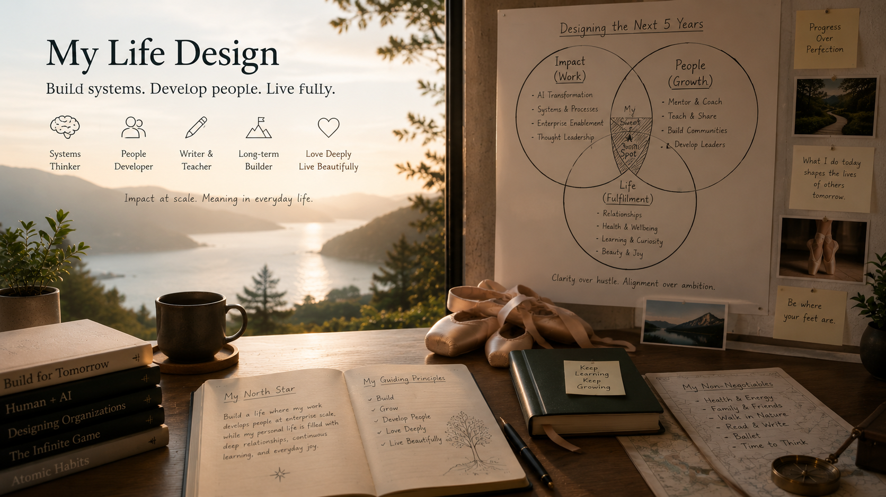
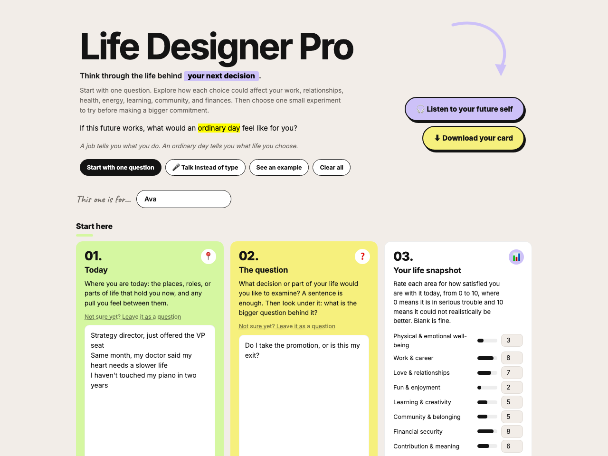

# Life Designer Pro

An AI-assisted life-design coach. Life Designer Pro helps you look at your work, relationships, health, fun, learning and creativity, community, finances, and contribution as one connected life, through an adaptive set of questions, three alternative future designs, and evidence-based experiments.

Inspired by ideas from [*Designing Your Life*](https://designingyour.life/) by [Bill Burnett](https://designingyour.life/about-us/) and [Dave Evans](https://designingyour.life/about-us/) and the [Stanford Life Design Lab](https://lifedesignlab.stanford.edu/). The life metaphor, heroes, and future-self letter draw on [*Design the Life You Love*](https://www.penguinrandomhouse.com/books/252264/design-the-life-you-love-by-ayse-birsel/) by [Ayse Birsel](https://www.aysebirsel.com/). The who-you-help lens adapts [*Business Model You*](https://businessmodelyou.com/) by Tim Clark with Alexander Osterwalder and Yves Pigneur. This is an independent adaptation, not affiliated with or endorsed by Stanford University or any of these authors.



**[Open the Life Canvas](https://wei-wei-hu.github.io/life-designer-pro/)** — free, private, in your browser. Nothing you type or say leaves it.

[](https://wei-wei-hu.github.io/life-designer-pro/)

## What makes this different

Most life-planning prompts jump from a few answers to a confident recommendation. This method slows down the diagnosis, distinguishes facts from assumptions, tracks repeated themes, tests contradictions, and produces practical experiments rather than a permanent verdict.

Its central test is simple:

> If this future works, what would an ordinary day feel like for you?

## See it in action

It starts with one simple question: what decision or part of your life would you like to examine? Then it follows the evidence, one plain question at a time. A fictional example:

> **Q:** What decision or part of your life would you like to examine?
>
> **Ava:** Do I take the promotion, or is this my exit? I was offered the VP seat the same month my doctor said my heart needs a slower life.

A few answers later, the whole thing fits on one page — the Life Map:

```text
[ TODAY: strategy director ]          [ LIFE SNAPSHOT ]
  the VP offer · the doctor's note      work 8 · well-being 3 · fun 2
              \                          /
               [ THE QUESTION ]
        do I take the promotion, or is this my exit?
                        |
          [ THREE ROADS · none a backup plan ]
 [ Take the VP seat ]  [ Stay, but smaller ]  [ The exit, with music ]
                        |
               [ THE SMALL TEST ]
    two weeks, nothing after 7pm, twenty minutes of piano
                        |
               [ WHAT TRAVELS WITH YOU ]
    Sunday mornings with my daughter · piano · real sleep
```

Three roads, all legitimate. One experiment small enough to start this week. And a letter from your future self that reads the roads against your own evidence and names your next best action — read it, or listen to it.

Two rules run through every output: nothing is invented ("not sure yet" is a welcome answer, and blanks become open questions instead of guesses), and every recommendation is a testable experiment, not a verdict.

## What you get

- **A letter from your future self:** key takeaways and recommendations in your own words, two years ahead — read it, or listen to it.
- **Your Life Map:** one page showing your current priorities, energy sources, tensions, and the areas of life that need more attention.
- **A printable card:** the letter inside, your map opposite, a cover that says who it's for. Print it for yourself, or fill it in for someone you love.
- **Your vision, as an image:** the card closes with an image prompt composed from your own answers. Paste it into any image tool and see your next chapter as one scene, like the one at the top of this page.

## The life-designer-pro skill package · members only

The canvas is the one-page version. Behind it is the complete life-designer-pro skill package: a guided coaching conversation for Claude Code and OpenAI Codex that asks the follow-up questions a page cannot, produces the full blueprint, life map, and prototype plan, and keeps them current with weekly to quarterly reviews and a daily reflection.

## Important limits

Life Designer Pro supports reflection and planning. It does not provide therapy, diagnosis, medical advice, legal advice, or financial advice.

## About the author

Life Designer Pro is created by [Weiwei Hu](https://www.linkedin.com/in/weiweihu/), who works at the intersection of big data, AI, and business decision-making, and writes about practical AI adoption for senior executives. She is the author of *Generative Engine Optimization (GEO): The Complete Playbook for Leaders to Win in AI Search*.

Weiwei Hu · [LinkedIn](https://www.linkedin.com/in/weiweihu/) · [Website](https://weiweihu.carrd.co/)

If this helped you find your real question, she would love to hear what it turned out to be.

## License

© 2026 Weiwei Hu. All rights reserved. Free to use at the link above; do not copy, redistribute, or adapt without permission.
